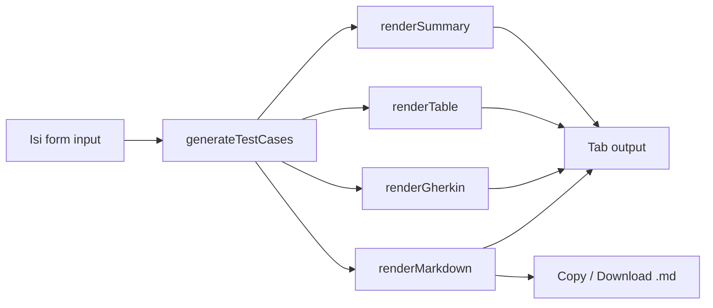

# Test Case Generator — IT Track QA Automation

Single-page, dependency-free generator that turns a user story into a QA test suite:
**positive / negative / boundary-value (BVA) / security** cases, each exportable as a
Gherkin BDD file or a Markdown test document. Built with pure Vanilla JS — no build step,
no framework, no runtime dependencies.

---

## Cara Menggunakan

### 1. Jalankan aplikasi

Buka `index.html` langsung di browser (double-click), atau serve foldernya lewat
Laragon / Apache / `npx http-server`. Tidak perlu install apa pun.

### 2. Isi form input

| Field | Fungsi | Contoh |
|-------|--------|--------|
| **Module / Feature Name** | Nama modul yang diuji; dipakai untuk prefix ID test case | `Authentication` |
| **User Story** | Cerita pengguna (wajib diisi) | `As a registered user, I want to log in using my email and password so that I can access my dashboard.` |
| **Input Fields** | Daftar field, pisahkan dengan koma | `Email, Password` |
| **Endpoint / Page URL** | URL halaman / endpoint yang diuji | `/login` |
| **Password Min / Max Length** | Batas panjang password untuk uji BVA | `8` / `64` |
| **Max Login Attempts** | Ambang kunci akun setelah gagal login | `5` |

### 3. Generate

Klik **⚡ Generate Test Cases**. Output muncul di panel bawah dengan 3 tab:

- **Test Case Table** — tabel lengkap: TC-ID, module, tipe, pre-condition, langkah, hasil yang diharapkan, status.
- **BDD Gherkin** — skenario Gherkin (Feature / Background / Scenario) siap dipakai di Cucumber, SpecFlow, dsb.
- **Raw Markdown** — dokumen test case format Markdown.

### 4. Ekspor hasil

- **📋 Copy Markdown** — salin dokumen Markdown ke clipboard.
- **⬇ Download .md** — unduh file `TC_<Module>_<tanggal>.md`.

### 5. Jalankan test otomatis (opsional)

```bash
npm test        # node --test, requires Node 18+
```

---

## Cara Kerja

### Alur umum



### 1. Engine generator — `generateTestCases()`

Fungsi inti di `src/app.js`. Menerima `{ module, story, fields, endpoint, minPass, maxPass, maxAtt }`
dan mengembalikan array objek test case. Setiap case punya: `id`, `type`, `module`, `title`,
`precondition`, `steps[]`, `expected`, `status`.

**ID test case** dibentuk dari prefix modul (maksimal 10 karakter) + nomor urut:
`TC-<MODUL>-<001>` — contoh `Authentication` menjadi `TC-AUTHENTICA-001`.

**Kategori yang dihasilkan:**

| Kategori | Tipe | Isi |
|----------|------|-----|
| ✅ Positive | `positive` | Operasi sukses dengan input valid, redirect ke halaman target, password di panjang minimum |
| ❌ Negative | `negative` | Password salah, akun tak dikenal, field kosong, format email salah, akun terkunci setelah N percobaan |
| ⚠ BVA | `bva` | Boundary value analysis pada panjang password: `min-1`, `min`, `max`, `max+1` |
| 🔒 Security | `security` | SQL Injection pada field 1, XSS pada field 2 |

**Logika kondisional:**
- Jika ada field berisi kata `password`/`pass`/`pwd` → case BVA password ikut dibuat.
- Jika ada field berisi `email`/`mail` → case format email invalid ikut dibuat.
- Jika `maxAtt > 0` → case lockout akun ikut dibuat.
- Jika tidak ada field password → case BVA dilewati (jumlah total menyesuaikan).

### 2. Renderer

| Fungsi | Output |
|--------|--------|
| `renderSummary()` | Bar ringkasan: total + jumlah per kategori |
| `renderTable()` | Tabel HTML lengkap (semua case) |
| `renderGherkin()` | Skenario BDD Gherkin dengan tag `@positive`, `@negative`, `@bva`, `@security` |
| `renderMarkdown()` | Dokumen Markdown: header, user story, tabel summary, tabel case, legend status |

### 3. Ekspor

- **Copy** memakai `navigator.clipboard.writeText()`.
- **Download** membuat `Blob` bertipe `text/markdown`, lalu memicu klik pada elemen `<a download>`.

### 4. Keamanan output

Semua teks user input dilewatkan `esc()` sebelum dirender ke HTML untuk mencegah
injection (XSS) dari data yang dimasukkan pengguna.

---

## Struktur Project

| Path | Purpose |
|------|---------|
| `index.html` | Input form, tabbed output |
| `src/app.js` | Generator engine + table / Gherkin / Markdown renderers |
| `src/style.css` | Layout and theming |
| `test/smoke.test.js` | Engine smoke tests via stubbed DOM |
| `package.json` | Script `npm test` |
| `.gitignore` | File yang dikecualikan dari git |